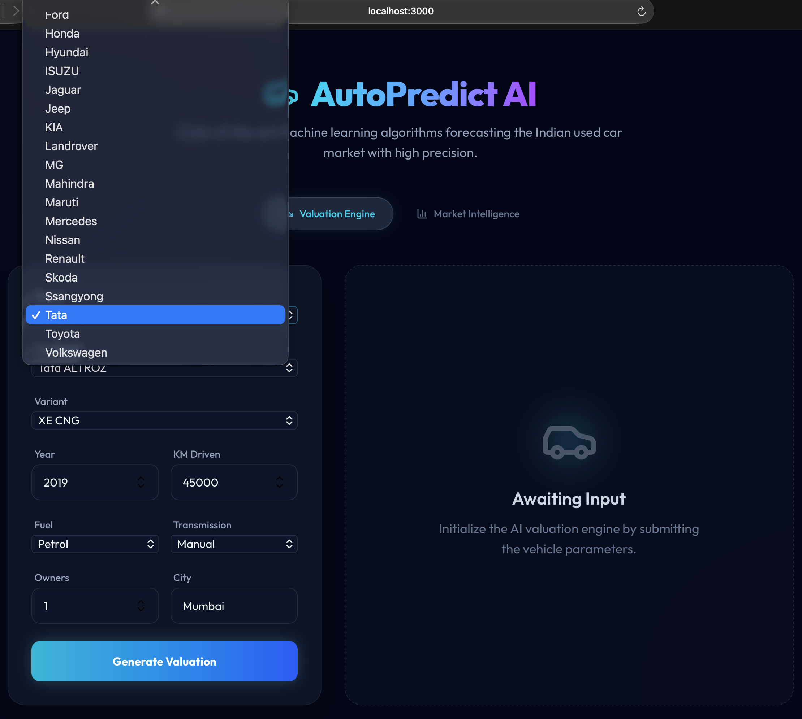
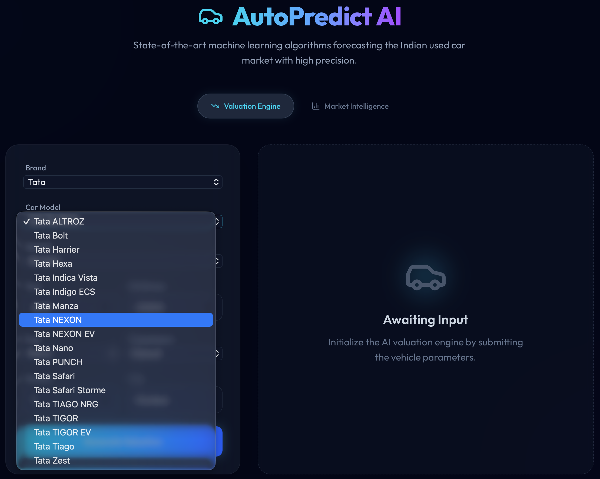
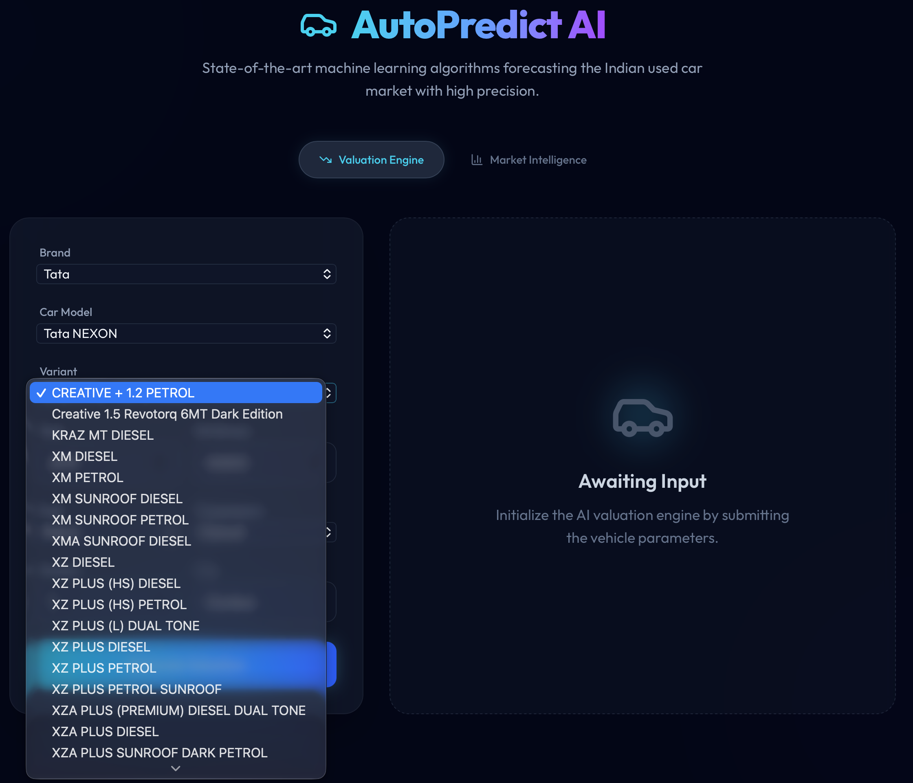
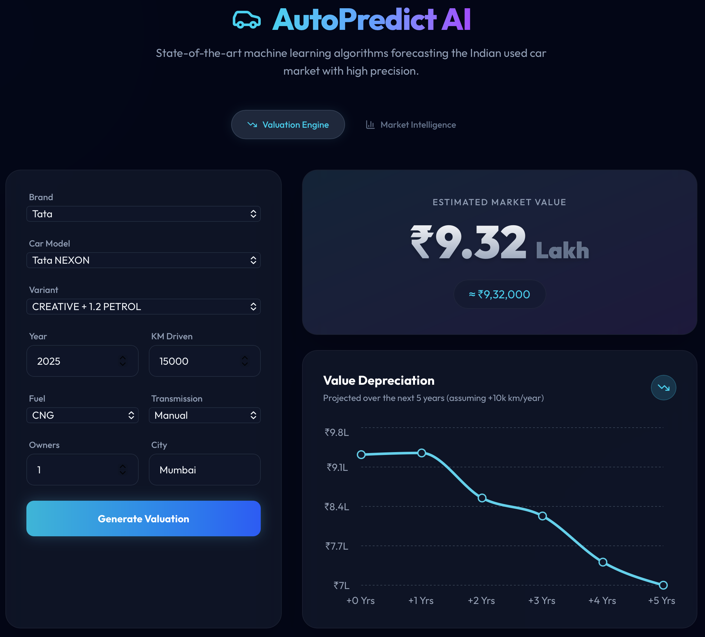
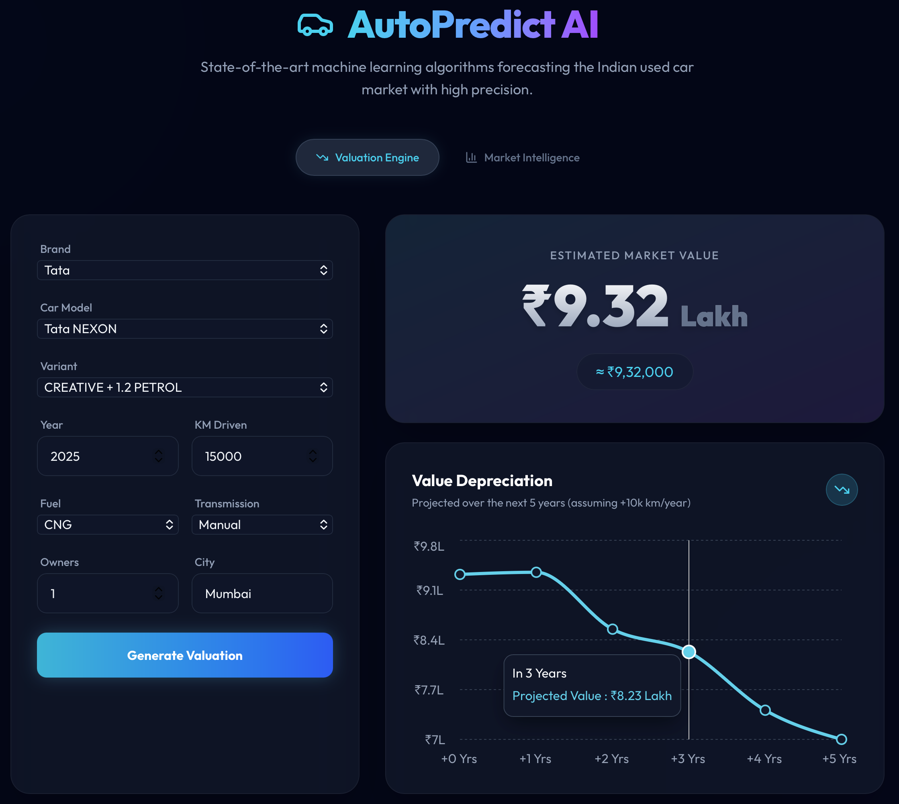
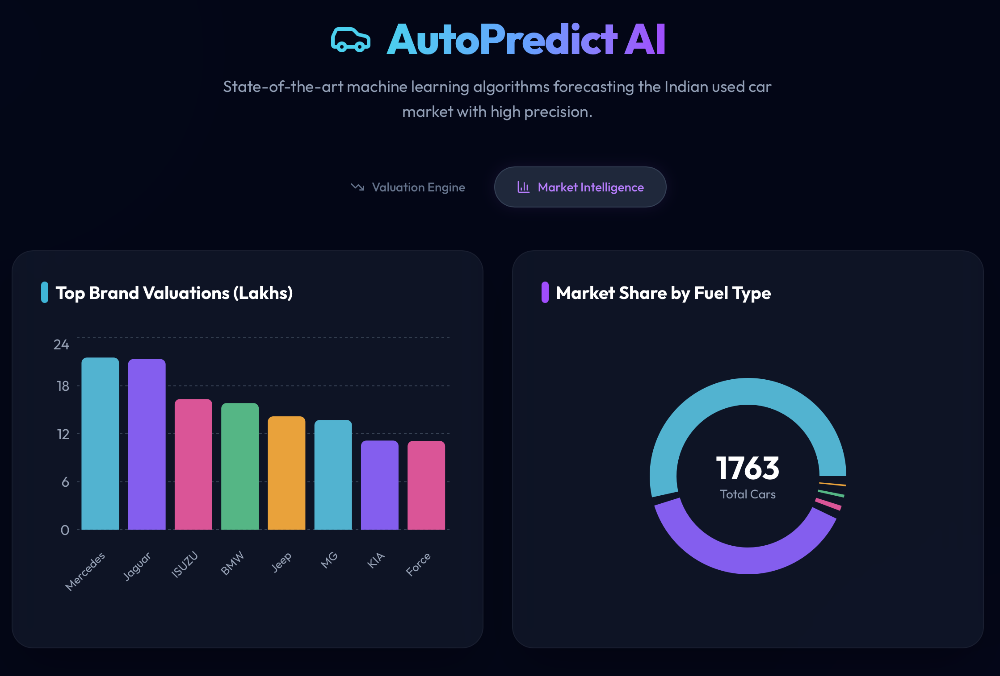
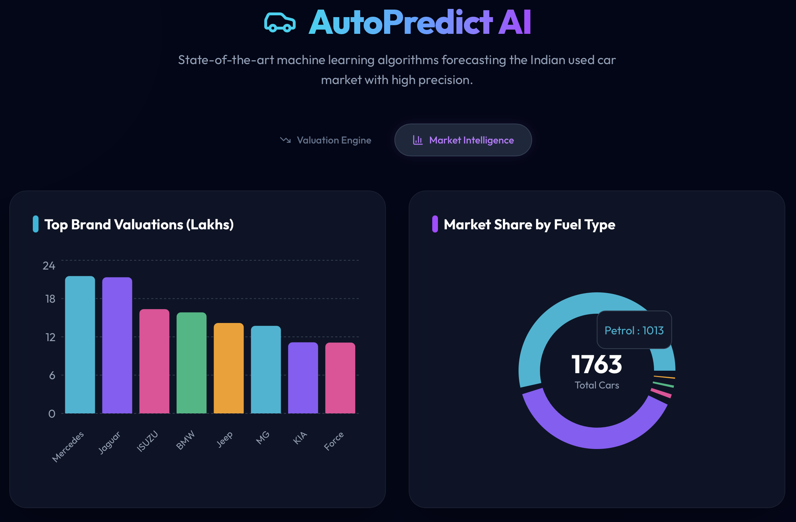

# AutoPredict AI — Indian Used Car Price Predictor

[](https://fastapi.tiangolo.com)
[](https://nextjs.org)
[](https://tailwindcss.com)
[](https://scikit-learn.org)

An end-to-end Machine Learning web application designed to forecast Indian used car market resale values with high precision. Built with a trained **Random Forest Regressor**, a high-performance **FastAPI** backend, and a modern, responsive **Next.js** frontend featuring real-time market intelligence and dynamic depreciation forecasting.

---

## Table of Contents
- [Overview](#overview)
- [Key Features](#key-features)
- [UI Showcase](#ui-showcase)
- [Machine Learning & Model Performance](#machine-learning--model-performance)
  - [Model Architecture & Dataset](#model-architecture--dataset)
  - [Evaluation Metrics](#evaluation-metrics)
  - [Hyperparameter Tuning Results](#hyperparameter-tuning-results)
  - [Key Feature Importances](#key-feature-importances)
- [Tech Stack](#tech-stack)
- [Project Structure](#project-structure)
- [Getting Started](#getting-started)
  - [Prerequisites](#prerequisites)
  - [Backend Setup](#backend-setup)
  - [Frontend Setup](#frontend-setup)
- [API Documentation](#api-documentation)
- [License](#license)

---

## Overview

Pricing used cars in the Indian automotive market is challenging due to the intricate interplay of vehicle age, usage (kilometers driven), localized demand, brand reputation, transmission preference, and fuel economics. 

**AutoPredict AI** addresses this problem with:
1. **Valuation Engine**: Generates an accurate resale price estimate along with a 5-year future depreciation forecast based on mileage accumulation and aging.
2. **Market Intelligence**: An interactive analytics dashboard visualizing resale valuations across car manufacturers and market share by fuel type.

---

## Key Features

- **Cascaded Dynamic Dropdowns**: Filter hierarchy automatically updates: `Brand` $\rightarrow$ `Car Model` $\rightarrow$ `Car Variant`.
- **Instant Price Valuation**: Generates valuation in both Lakhs (₹) and full INR currency format.
- **5-Year Value Depreciation Curve**: Simulates projected depreciation over the next 5 years (assuming standard annual usage of ~10,000 km/year).
- **Market Intelligence Dashboard**:
  - **Top Brand Valuations**: Interactive bar chart comparing average market prices across top automobile brands.
  - **Fuel Type Market Share**: Interactive donut chart breaking down vehicle distributions (Petrol, Diesel, CNG, Electric, Hybrid).
- **Modern Dark UI**: Designed with Tailwind CSS v4, smooth animations via Framer Motion, and interactive data visualizations powered by Recharts.

---

## UI Showcase

| Valuation Form & Cascading Filters | Model & Variant Selection |
| :---: | :---: |
|  |  |

| Variant Selection | Valuation Result & Depreciation Curve |
| :---: | :---: |
|  |  |

| Interactive Depreciation Tooltip | Market Intelligence Overview |
| :---: | :---: |
|  |  |

| Fuel Market Share Analytics |
| :---: |
|  |

---

## Machine Learning & Model Performance

### Model Architecture & Dataset
- **Algorithm:** Random Forest Regressor
- **Dataset:** Cars24 Indian used-car dataset
- **Input Features (8 features total):**
  1. `Year` (Numeric) — Year of manufacture
  2. `KM_Driven` (Numeric) — Total distance driven
  3. `Owner_Count` (Numeric) — Number of previous owners
  4. `Car_Model` (Categorical) — Car make and model
  5. `Car_Variant` (Categorical) — Specific trim/edition
  6. `Fuel_Type` (Categorical) — Petrol, Diesel, CNG, Electric, Hybrid
  7. `Transmission_Type` (Categorical) — Manual, Automatic
  8. `City` (Categorical) — City of registration / sale

### Evaluation Metrics
Evaluated on an independent holdout test set (1,763 vehicles):

| Metric | Score | Description |
| :--- | :--- | :--- |
| **MAE** | **1.1909 Lakh** | Average absolute error in price prediction is ~₹1.19 Lakh |
| **RMSE** | **2.1897 Lakh** | Root Mean Squared Error penalizing larger residual errors |
| **$R^2$** | **0.8160** | The model explains **~81.6%** of the variance in car prices |

### Hyperparameter Tuning Results
During model development, multiple architectures and regularization configurations were evaluated:

| Model Configuration | MAE (Lakhs) | RMSE (Lakhs) | $R^2$ Score |
| :--- | :---: | :---: | :---: |
| **Final Tuned Random Forest** | **1.1909** | **2.1897** | **0.8160** |
| More Features | 1.3818 | 3.1943 | 0.6814 |
| Baseline-style | 1.3533 | 3.2606 | 0.6680 |
| Deeper Trees | 1.6380 | 3.4199 | 0.6348 |
| Regularized | 1.8635 | 3.6886 | 0.5751 |

### Key Feature Importances
Top contributors to vehicle price predictions:
- **`Year`**: 34.71% — Vehicle age is the single strongest price determinant.
- **`Transmission_Type_Manual`**: 9.33% & **`Transmission_Type_Automatic`**: 7.59% — Automatic variants command significant premiums.
- **`Fuel_Type_Diesel`**: 7.20% — Diesel engines strongly impact resale value.
- **`KM_Driven`**: 6.46% — Accumulated vehicle usage.
- **`City_New Delhi`**: 2.99% — Regional demand variation.
- **`Fuel_Type_Petrol`**: 2.78% — Petrol pricing dynamics.
- **Specific High-Value Models**: Toyota Fortuner (1.45%), Toyota Innova Crysta (1.18%), BMW X3 (0.68%), Hyundai Creta (0.67%).

---

## Tech Stack

### Frontend
- **Framework:** [Next.js](https://nextjs.org/) (v16 App Router)
- **Library:** [React](https://react.dev/) (v19)
- **Styling:** [Tailwind CSS](https://tailwindcss.com/) (v4 with `@tailwindcss/postcss`)
- **Visualizations:** [Recharts](https://recharts.org/) (Interactive Line, Bar, and Donut charts)
- **Animations:** [Framer Motion](https://www.framer.com/motion/)
- **Icons:** [Lucide React](https://lucide.dev/)
- **Language:** TypeScript

### Backend & Machine Learning
- **API Framework:** [FastAPI](https://fastapi.tiangolo.com/)
- **ASGI Server:** [Uvicorn](https://www.uvicorn.org/)
- **Data Validation:** [Pydantic](https://docs.pydantic.dev/)
- **ML Framework:** [scikit-learn](https://scikit-learn.org/) (v1.6.1)
- **Data Processing:** [Pandas](https://pandas.pydata.org/), [NumPy](https://numpy.org/)
- **Model Persistence:** [joblib](https://joblib.readthedocs.io/)

---

## Project Structure

```
.
├── backend/
│   ├── main.py                                # FastAPI application and API routes
│   ├── random_forest_final.joblib             # Serialized model pipeline & preprocessor
│   └── requirements.txt                       # Python dependencies
├── frontend/
│   ├── public/
│   │   └── car_categories.json                # Pre-extracted car models, variants, and cities
│   ├── src/
│   │   └── app/
│   │       ├── globals.css                    # Tailwind CSS v4 styling & theme setup
│   │       ├── layout.tsx                     # Root layout with Outfit font & dark mode
│   │       └── page.tsx                       # Main AutoPredict AI application UI
│   ├── .env.local                             # Frontend environment configuration
│   ├── next.config.ts                         # Next.js configuration
│   ├── package.json                           # Node.js dependencies and scripts
│   ├── postcss.config.mjs                     # PostCSS config for Tailwind v4
│   └── tsconfig.json                          # TypeScript configuration
├── screenshots/                               # Application screenshots (UI showcase)
│   ├── 1.png ... 7.png
├── random_forest_final_feature_importance.csv # Feature importance weights
├── random_forest_final_predictions.csv        # Holdout test set predictions & actuals
├── random_forest_tuning_results.csv           # Model tuning experimentation results
└── README.md
```

---

## Getting Started

### Prerequisites
- **Python 3.9+**
- **Node.js 18+** & **npm**

### Backend Setup

1. **Navigate to the backend folder:**
   ```bash
   cd backend
   ```

2. **Create and activate a virtual environment:**
   ```bash
   # macOS / Linux:
   python3 -m venv venv
   source venv/bin/activate

   # Windows:
   venv\Scripts\activate
   ```

3. **Install dependencies:**
   ```bash
   pip install -r requirements.txt
   ```

4. **Start the FastAPI server:**
   ```bash
   uvicorn main:app --reload
   ```
   The backend API will run at `http://127.0.0.1:8000`. Interactive Swagger API docs are available at `http://127.0.0.1:8000/docs`.

### Frontend Setup

1. **Navigate to the frontend folder:**
   ```bash
   cd frontend
   ```

2. **Configure environment variables:**
   Ensure `.env.local` contains the backend API URL:
   ```env
   NEXT_PUBLIC_API_URL=http://127.0.0.1:8000
   ```

3. **Install dependencies:**
   ```bash
   npm install
   ```

4. **Run the development server:**
   ```bash
   npm run dev
   ```
   Open `http://localhost:3000` in your browser.

---

## API Documentation

Interactive OpenAPI / Swagger documentation is available at `http://127.0.0.1:8000/docs`.

### `GET /`
Returns the status message of the API.
```json
{
  "message": "Used Car Price Predictor API is running"
}
```

### `GET /health`
Returns system health and verifies whether the machine learning model is loaded in memory.
```json
{
  "status": "healthy",
  "model_loaded": true
}
```

### `GET /filters`
Returns the hierarchical brand, model, and variant taxonomy derived from market records.
```json
{
  "Honda": {
    "Honda City": ["1.5L I-VTEC V", "1.5L I-VTEC VX", "VX"],
    "Honda Amaze": ["1.2 VX", "1.2 S"]
  },
  "Tata": {
    "Tata NEXON": ["CREATIVE + 1.2 PETROL", "XZ PLUS DIESEL"]
  }
}
```

### `GET /dashboard-data`
Returns pre-calculated market aggregates for the intelligence dashboard:
- `avg_price_by_brand`: Average price by manufacturer.
- `fuel_type_dist`: Market volume broken down by fuel type.
- `scatter_data`: Sampled mileage vs. price data points.

### `POST /predict`
Predicts the used car resale valuation.

**Request Body:**
```json
{
  "Year": 2019,
  "Car_Model": "Honda City",
  "Car_Variant": "VX",
  "KM_Driven": 45000,
  "Fuel_Type": "Petrol",
  "Transmission_Type": "Manual",
  "Owner_Count": 1,
  "City": "Mumbai"
}
```

**Response:**
```json
{
  "predicted_price_lakhs": 6.64,
  "predicted_price_inr": 664000,
  "currency": "INR"
}
```

### `POST /predict-depreciation`
Computes future resale value projections over the next 5 years (assuming standard annual driving usage).

**Request Body:** Same schema as `/predict`.

**Response:**
```json
{
  "depreciation_curve": [
    {
      "year_offset": 0,
      "simulated_mfg_year": 2019,
      "simulated_km": 45000,
      "predicted_price_lakhs": 6.64
    },
    {
      "year_offset": 1,
      "simulated_mfg_year": 2018,
      "simulated_km": 55000,
      "predicted_price_lakhs": 6.12
    },
    {
      "year_offset": 2,
      "simulated_mfg_year": 2017,
      "simulated_km": 65000,
      "predicted_price_lakhs": 5.65
    },
    {
      "year_offset": 3,
      "simulated_mfg_year": 2016,
      "simulated_km": 75000,
      "predicted_price_lakhs": 5.15
    },
    {
      "year_offset": 4,
      "simulated_mfg_year": 2015,
      "simulated_km": 85000,
      "predicted_price_lakhs": 4.70
    },
    {
      "year_offset": 5,
      "simulated_mfg_year": 2014,
      "simulated_km": 95000,
      "predicted_price_lakhs": 4.28
    }
  ]
}
```

---

## License

This project is licensed under the MIT License — feel free to use and adapt for your own machine learning applications.
